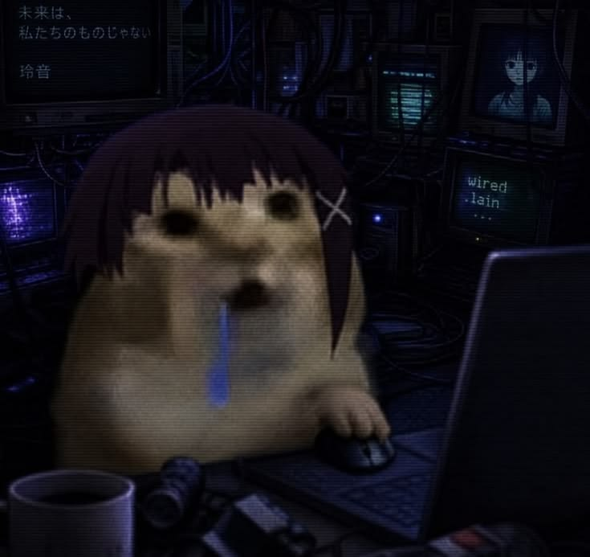

# Checkpoint

**Seu espaço para descobrir, avaliar e organizar jogos!**

O Checkpoint é uma aplicação web de catálogo de jogos, inspirada em plataformas como o Letterboxd. A proposta é permitir que os usuários explorem jogos, conheçam seus detalhes, assistam aos trailers e registrem suas próprias experiências.

O projeto foi desenvolvido com PHP, MySQL e JavaScript, além da integração com APIs externas, buscando oferecer uma experiência simples e intuitiva para quem gosta de videogames.

---

## Acesse a aplicação

**[Checkpoint – Acessar plataforma](https://checkpoint-catalog.site.je/frontend/login.php)**

A aplicação está hospedada gratuitamente na [InfinityFree](https://www.infinityfree.com/).

## Funcionalidades

- **Cadastro e login:** criação de contas e acesso individual à plataforma.
- **Catálogo de jogos:** exibição de jogos com informações e imagens obtidas através da API RAWG.
- **Detalhes dos jogos:** visualização de informações sobre cada título.
- **Trailers:** possibilidade de assistir aos trailers dos jogos através da integração com o YouTube.
- **Avaliações:** registro de avaliações dos jogos.
- **Gerenciamento de conta:** funcionalidades relacionadas à sessão e ao acesso do usuário.
- **Interface responsiva:** adaptação das páginas para diferentes tamanhos de tela.

## Tecnologias utilizadas

<p align="center">
  
</p>

| Tecnologia | Utilização |
|---|---|
| PHP | Desenvolvimento do backend e regras da aplicação. |
| MySQL | Armazenamento dos dados dos usuários e da aplicação. |
| PDO | Comunicação entre PHP e banco de dados. |
| HTML5 | Estrutura das páginas. |
| CSS3 | Estilização e responsividade. |
| JavaScript | Interações e comportamentos da interface. |
| Bootstrap | Auxílio na construção dos componentes visuais. |
| Docker | Criação do ambiente de desenvolvimento. |
| Git | Controle de versão e acompanhamento das alterações no código. |
| GitHub | Hospedagem do repositório e colaboração no projeto. |

## APIs e bibliotecas

O Checkpoint também utiliza recursos externos para complementar suas funcionalidades.

- **[RAWG API](https://rawg.io/):** utilizada para obter informações, imagens e detalhes dos jogos exibidos no catálogo.
- **[YouTube Data API v3](https://developers.google.com/youtube/v3):** utilizada para buscar e disponibilizar os trailers dos jogos.
- **[Lucide Icons](https://lucide.dev/):** biblioteca de ícones utilizada na interface.
- **[Icons8](https://icons8.com/icons/set/favicon-game):** referência utilizada para o favicon da aplicação.

## Como executar o projeto localmente

Para executar o Checkpoint na sua máquina, você precisará ter instalado:

- [Git](https://git-scm.com/)
- [Docker Desktop](https://www.docker.com/products/docker-desktop/)

### 1. Clone o repositório

Abra o terminal e execute:

```bash
git clone URL_DO_REPOSITORIO
```

Entre na pasta do projeto:

```bash
cd games-catalog
```

### 2. Configure as variáveis de ambiente

O projeto utiliza chaves de API para acessar os serviços externos.

Configure as seguintes variáveis no ambiente utilizado pelo PHP:

```env
RAWG_API_KEY=sua_chave_rawg
YOUTUBE_API_KEY=sua_chave_youtube
```

As chaves devem ser obtidas nos respectivos serviços:

- [Obter chave da RAWG API](https://rawg.io/apidocs)
- [Obter chave da YouTube Data API v3](https://console.cloud.google.com/)

**Importante:** não compartilhe suas chaves secretas publicamente nem as envie para o GitHub.

### 3. Inicie os containers

Com o Docker Desktop aberto, execute:

```bash
docker compose up -d
```

Esse comando inicia os serviços necessários para executar a aplicação, incluindo o PHP e o banco de dados MySQL.

### 4. Acesse a aplicação

Após os containers iniciarem, abra o navegador e acesse:

```text
http://localhost:8082/backend/auth/login.php
```

Pronto! A aplicação estará disponível localmente.

### 5. Encerrando a aplicação

Para encerrar os containers, utilize:

```bash
docker compose down
```

## Hospedagem

O projeto também possui uma versão publicada na internet através da plataforma [InfinityFree](https://www.infinityfree.com/).

Acesse pelo link:

**[https://checkpoint-catalog.site.je/frontend/login.php](https://checkpoint-catalog.site.je/frontend/login.php)**

## Organização do projeto

O projeto está organizado em duas partes principais:

- **Frontend:** responsável pelas páginas, estilos, imagens e interações da interface.
- **Backend:** responsável pela autenticação, conexão com o banco de dados, regras de negócio e integração com APIs.

Essa separação ajuda a manter o código organizado e facilita a manutenção da aplicação.

## Créditos

O Checkpoint foi desenvolvido em colaboração, com a participação de:

- **Ana Luiza:** desenvolvimento da aplicação e implementação das funcionalidades.
- **Kaique:** responsável pela documentação do projeto.

## Considerações finais

O Checkpoint foi desenvolvido como um projeto de aprendizado e prática, permitindo explorar conceitos de desenvolvimento web, integração com APIs, banco de dados, autenticação de usuários e organização de código.

Mais do que um catálogo de jogos, o projeto representa a aplicação prática dos conhecimentos adquiridos durante nossa jornada de desenvolvimento.

---

<p align="center">
  <strong>Checkpoint — Seu próximo jogo começa aqui!</strong>
</p>

<p align="center">
  
</p>
